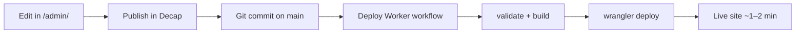

# CMS — save, deploy & error checklist

Use this when something fails after **Publish** in `/admin/`.

## `/admin/` shows the portfolio instead of CMS

The main site PWA service worker can cache the wrong page for `/admin/`. After a deploy fix:

1. Open the **portfolio home page** once (loads the updated service worker).
2. Or clear site data: browser settings → site data → remove `portfolio.chaoticstudio.workers.dev`.
3. Open `/admin/` in a **private/incognito** window.

You should see **Chaos Studio CMS** in the tab title, not the portfolio.

## Stuck on “Loading entry…”

Usually the **CMS field types** do not match the JSON on GitHub (for example tags saved as `["a","b"]` but the CMS expected `{tag:"a"}` objects). The admin `config.yml` must use **string lists** (list + `field: { widget: string }` without a nested `name`).

After a deploy fix:

1. Hard-refresh `/admin/` (Ctrl+Shift+R).
2. Open **Social posts** or **Site content** again.

If it still spins, open DevTools → **Console** for red errors (403 = log out and log in again with GitHub).

## Save → GitHub → deploy flow



## Before you publish

| Check | Why |
|--------|-----|
| **Post ID** matches folder under `images/posts/{id}/` | Broken images on site |
| **Tags** — one keyword per row, not `{tag: "…"}` objects | Build fails `validate:cms` |
| **SEO & projects** — only edit if you need meta/work/clients | Form now keeps `brand`, `social`, `clients` (older CMS could wipe them) |
| Image uploads under **Media** | Path: `frontend/public/images/posts/` |

## After publish

1. **GitHub → Actions → Deploy Worker** — must be green on `main`.
2. Wait ~1–2 minutes.
3. Hard-refresh the site (PWA may cache old JSON/CSS).

## Common errors

| Symptom | Fix |
|---------|-----|
| **Repo not found** | Log out, log in again; approve **repo** scope; grant org access to OAuth app for **CHAOTIC-RAY** |
| **Not Found** on login popup | `cms-auth` not deployed — re-run Deploy Worker; check `CMS_OAUTH_*` secrets |
| **CMS OAuth is not configured** | Add `CMS_OAUTH_CLIENT_ID` + `CMS_OAUTH_CLIENT_SECRET` in Actions secrets, redeploy |
| Publish works but site unchanged | Deploy failed — open Actions log; fix `validate:cms` or build errors |
| **Failed to persist** / 403 on save | Need **write** access to repo; check branch protection (CMS must push to `main`) |
| Images missing after save | Post ID ≠ folder name; or deploy still running |
| Media tab shows few files | Normal — Decap only lists **root** uploads. Use **All post images** at top of Media tab for folders |
| Tags/posts look wrong | Re-edit tags as plain lines; run `npm run validate:cms` locally |

## GitHub secrets (Actions)

| Secret | Purpose |
|--------|---------|
| `CLOUDFLARE_API_TOKEN` | Deploy portfolio + cms-auth |
| `CLOUDFLARE_ACCOUNT_ID` | Account ID |
| `CMS_OAUTH_CLIENT_ID` | Decap GitHub login (not `GITHUB_*` — blocked by GitHub) |
| `CMS_OAUTH_CLIENT_SECRET` | OAuth client secret |

## Local checks

```bash
npm run validate:cms   # JSON shape guardrails
npm run build          # includes validation + sync
```

## Branch protection

If `main` requires pull requests, **Decap cannot push** until you allow the OAuth user/bot to bypass rules or disable protection for CMS commits.
